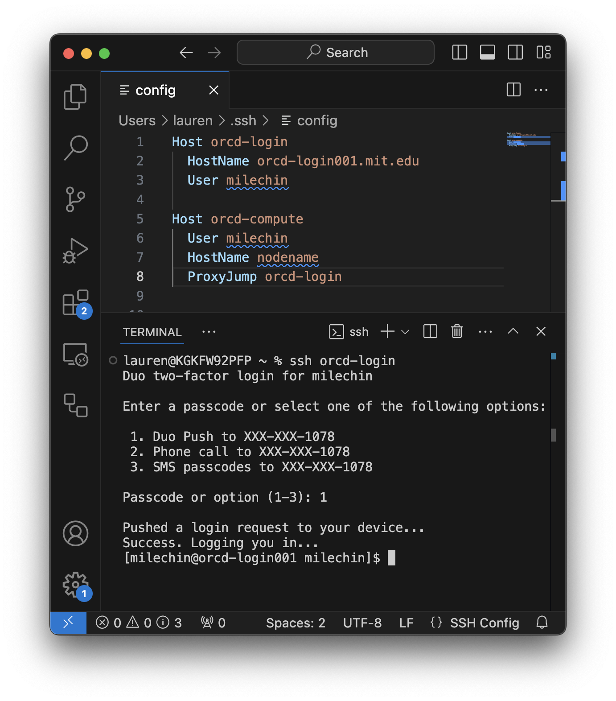
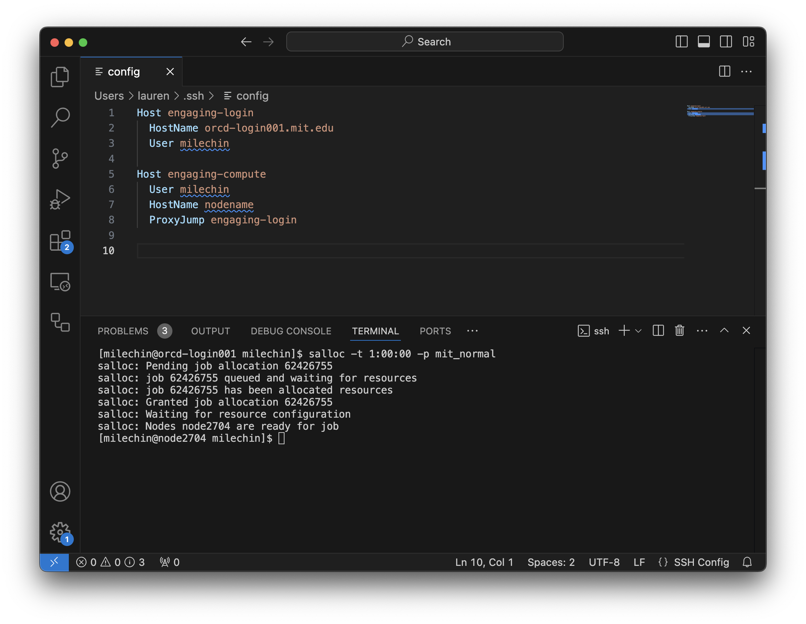
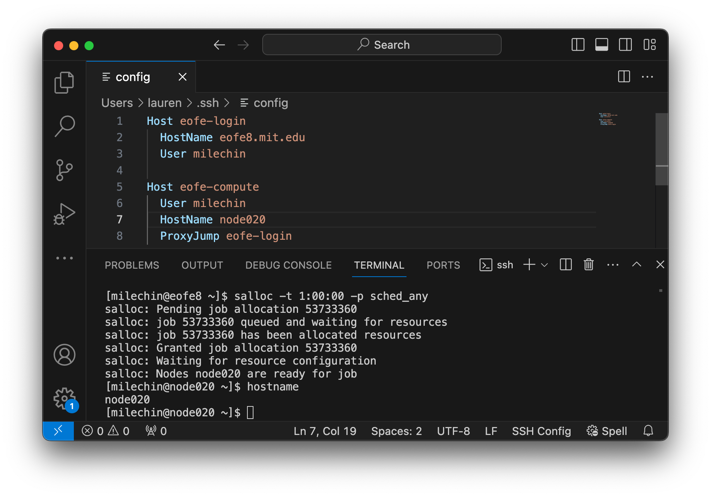
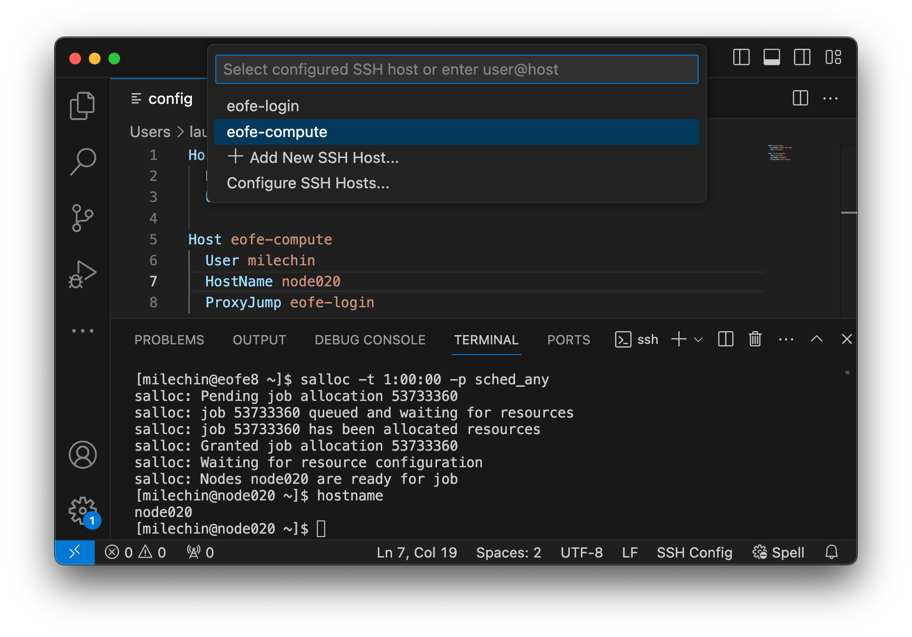

---
tags:
 - Howto Recipes
 - Best Practices
---
# Using VSCode on Engaging

There are three ways you can run VSCode on Engaging:

- Using the [Code Server App](#code-server-vscode-ondemand-app) on [ORCD OnDemand](https://orcd-ood.mit.edu)
- Connecting to a compute node with the [RemoteSSH](#remotessh) VSCode Extension
- Connecting to a compute node with the [RemoteTunnel](#remote-tunnel) VSCode Extension

The easiest and least error-prone is to use the Code Server OnDemand app. If for some reason this doesn't work for you, another option is to connect your desktop VSCode to a compute node on Engaging with either the RemoteSSH or RemoteTunnel VSCode extension. If you are using Cursor you will have to connect with RemoteSSH.

!!! Warning "Do not run VSCode on the login nodes"
    Please do not run VSCode or Cursor on the login nodes. The login nodes have resource limits that may cause VSCode or Cursor to disconnect. Instead, follow the instructions below to run VSCode or Cursor on a compute node.

## Code Server (VSCode) OnDemand App

The Code Server OnDemand App will start up a VSCode-style editor in your browser. It will run this as a job on an Engaging compute node.

To start, first log into [ORCD OnDemand](https://orcd-ood.mit.edu). Select "Interactive Apps" -\> "Code Server (VS Code)". Fill out the form to specify how long you want your job to run, number of CPUs, amount of Memory, and whether to allocate a GPU. You can also specify a different partition if you would like to run on your group's partition. Click "Launch" to start the job. Once your job has started you should see a "Connect to VS Code" button, click this button to open your session.

## RemoteSSH

VSCode is a convenient IDE for development, and one of its nicest features is its ability to run on a remote system using its RemoteSSH extension. This means you can have the VSCode window on your computer, while the files and anything you run will be on the remote system you are connected to.

Once you've installed the RemoteSSH extension this is fairly easy to set up. However, it is also very easy to set up in such a way that it is not only slow for you, but it also puts excess load on the login nodes and in turn slows things down for others on that node. Luckily, with a few extra steps you can run VSCode on a compute node where it can have more resources to run and won't impact others as much. Most of these instructions apply to Cursor as well.

### Step 0: Set Up

There are a few configuration steps that you'll have to do to set up VSCode or Cursor to run on Engaging. You only have to do these once. These are:

1. Adjust a few RemoteSSH Extension settings
1. Create an SSH Key if you haven't already
1. Create an SSH Config file

These steps are covered in the following sections. If you've already done these, you can skip to [Starting your VSCode Session on a Compute Node](#starting-your-vscode-session-on-a-compute-node).

#### Adjust the RemoteSSH Extension Settings

Before you start, it is helpful to adjust VSCode's [RemoteSSH Extension settings](vscode://settings/remote.SSH). Sometimes VS Code may cause you to be locked out of your Engaging account because it makes repeated Duo authentication attempts. To mitigate this behavior, edit a few of the VS Code settings:

- [Remote.SSH: Connect Timeout](vscode://settings/remote.SSH.connectTimeout): Set to 60 seconds. Making this longer gives you more time to accept the Duo push before the RemoteSSH extension tries again.
- [Remote.SSH: Max Reconnection Attempts](vscode://settings/remote.SSH.maxReconnectionAttempts): Set to 0. This prevents RemoteSSH from trying to reconnect automatically over and over, sending you Duo pushes when you aren't expecting them. This can sometimes cause you to get locked out of your account for a short period of time. When you set this to 0 VSCode will ask you before trying to reconnect. You can also safely set this to 1 to allow it to make a single reconnection attempt.

!!! Note "Some Settings Unavailable in Cursor"
    Cursor may have some, but not all, of these settings. At the time of writing, Cursor has the [Connect Timeout](cursor://settings/remote.SSH.connectTimeout) setting, but not Max Reconnection Attempts.

#### Setting up your SSH Key and Config File

You will need an SSH Key to run VSCode or Cursor on a compute node. If you haven't set up SSH keys yet, refer to the [SSH Key Setup guide](../accessing-orcd/ssh-setup.md).

To set up your SSH Config file, click the "Open a Remote Window" button in the bottom left corner of your VSCode window (It is a small blue rectangle labeled with `><`). In the bar at the top of the page select "Connect to Host...", then "Configure SSH Hosts", and select the first option, which will differ depending on your operating system. This will open your config file in a VSCode tab.

To run on a compute node you will need at least 2 entries in this file. The first will be a login node that you'll "jump" through and the second will be the compute node that is your final destination.

    
```yaml title="config"
Host orcd-login
    HostName orcd-login.mit.edu
    User USERNAME

Host orcd-compute
    User USERNAME
    HostName nodename
    ProxyJump orcd-login
```

Replace `USERNAME` with your username on the system you are connecting to. We will fill in `nodename` later.

When making any connections you will be asked for your password in the bar at the top of the window, followed by which 2-Factor method you would prefer. Enter "1" for the default method that you've set up. After responding to your 2-factor authentication you should be connected. You can skip the Password and 2-Factor step by first logging into [https://orcd-ood.mit.edu](https://orcd-ood.mit.edu).

!!! note "SSH Key Required"
    To use VSCode on a compute node, an SSH key is required. If you haven't set up SSH keys yet, refer to the [SSH Key Setup guide](../accessing-orcd/ssh-setup.md).

### Starting your VSCode Session on a Compute Node

Each time you sit down to do remote work through VSCode you will have three steps:

1. Start an interactive job on the target system and note the name of the node your job is running on
2. Update your config file with the node name
3. Connect to the compute node using your updated config

We go through these steps in detail below.

#### Step 1: Start an Interactive Job

Open a terminal window and ssh into the login node. If you are not used to doing this you can open a terminal in VSCode and run:

```bash
ssh orcd-login
```

Use the name you have used for the login `Host` in your config file if different than the one above. The example screenshot below shows logging into one of the Engaging login nodes with ssh in a VSCode terminal window.



Once you are logged in start an interactive session. If you are planning to only edit files a single core may be sufficient, but if you plan to run code or Jupyter Notebooks you may want to allocate more resources accordingly. Refer to the [Running Jobs Overview](https://orcd-docs.mit.edu/running-jobs/overview/) on how to request an interactive job. Note that at this point VSCode is *not* yet running on a compute node, only your terminal session is.

Once your job has started you can run the `hostname` command to get the name of the node your interactive job is running on. You can also run the `squeue --me` command to list all your running jobs and get the hostname from the last column.

The screenshot below shows requesting a single interactive core for 1 hour on Engaging:



```bash
salloc -t 1:00:00 -p mit_normal
```

Note that the scheduler will also tell you which node you have been allocated in its output. In this screenshot my node name is `node2704`.

#### Step 2: Update your Config File

Update the `HostName` of your compute node entry in your config file. If your config file is not open, follow the instructions [above](#setting-up-your-ssh-key-and-config-file) to open it again. Then replace whatever you have for `HostName` in your config file with the output of the `hostname` command you ran in your interactive session, or got from `squeue --me`.

If your compute node is `node1234` then your config file should look something like:

```yaml title="config"
Host orcd-login
    HostName orcd-login.mit.edu
    User USERNAME

Host orcd-compute
    User USERNAME
    HostName node1234
    ProxyJump orcd-login
```

Where `USERNAME` is replaced by your username.

This screenshot shows updating the config file for an interactive job running on Engaging:



Since the interactive job in my screenshot is running on `node2704`, I have updated `HostName` to `node2704` for the `orcd-compute` entry in my config file.

#### Step 3: Connect to the Compute Node

You are ready to connect to the compute node you have allocated through your interactive job from VSCode. Select the "Open a Remote Window" button in the bottom left corner of your VSCode window. In the bar at the top of the page select "Connect to Host..." and select the Host for the compute node that you have created.

In the example config file above this would be `orcd-compute`.

Here is what this might look like:



## Remote Tunnel

The Remote Tunnel extension allows you to fairly easily start VSCode as a job on Engaging and connect to it with VSCode running on your own computer. While it works well for VSCode, it is unavailable in Cursor.

### Step 1: Create a Job Script and Submit as a Job

Step 1 is to submit the job with the attached script. You can adjust the job flags as needed (for example, use your group's partition if you'd like). This job should run for as long as the time limit, and if your VSCode session ever gets disconnected you can easily reconnect.

```bash title="vscode_tunnel.sh"
#!/bin/bash
#SBATCH -p mit_normal         # partition. Remember to change to a desired partition
#SBATCH --mem=4g        # memory in GB
#SBATCH --time=02:00:00 # time in HH:MM:SS
#SBATCH -c 4            # number of cores
#SBATCH -o vscode_tunnel.out

set -o errexit -o nounset -o pipefail
MY_SCRATCH=~/orcd/scratch
echo $MY_SCRATCH

#Obtain the tarball and untar it in $MY_SCRATCH location to obtain the
#executable, code, and run it using the provider of your choice
curl -Lk 'https://code.visualstudio.com/sha/download?build=stable&os=cli-alpine-x64' | tar -C $MY_SCRATCH -xzf -

#VSCODE_CLI_DISABLE_KEYCHAIN_ENCRYPT=1 $MY_SCRATCH/code tunnel user login --provider github
VSCODE_CLI_DISABLE_KEYCHAIN_ENCRYPT=1 $MY_SCRATCH/code tunnel user login --provider microsoft

#Accept the license terms & launch the tunnel
$MY_SCRATCH/code tunnel --accept-server-license-terms --name engagingtunnel
```

Once you have this script in your Engaging account you can start a VSCode job at any time with:

```bash
sbatch vscode_tunnel.sh
```

!!! Warning
    Do not run this job in a shared directory. Anyone who has access to your log file will be able to connect to your VSCode Tunnel. Instead, keep this script in your Home Directory and run it from there.

### Step 2: Check the Log File

Once the job is running, check the bottom of the log file `vscode_tunnel.out`. The log will contain a code that it'll instruct you to enter at [https://login.microsoft.com/device](https://login.microsoft.com/device). After you enter the code log in with your MIT Kerberos.

### Step 3: Connect To Your Tunnel

Open VSCode on your desktop. Click the "Open a Remote Window" button in the bottom left corner of your VSCode window. It is a small blue rectangle labeled with `><`, the same button used to open a RemoteSSH session. Choose "Connect to Tunnel" and select "Microsoft Account" for authentication. You'll be prompted to log in through your browser.

After that you should see an option for `engagingtunnel`.

If you don't see the "Connect to Tunnel" option you may need to install the Remote Tunnel extension first.

## Other VSCode Best Practices, Tips, and Tricks

- Avoid running VSCode through RemoteSSH on the login nodes. If you are only editing files this might be okay, although it is not encouraged. Beyond editing files please use a compute node for VSCode, as described on this page.
- Add only the specific directories you need to your workspace. VSCode constantly scans all the files files and runs git commands on any local git repositories in your workspace, and it does this recursively. For this reason adding high-level directories to your workspace can slow things down quite a bit. For example, avoid adding your entire home directory or group storage to your VSCode session workspace.
- If VSCode is slow to start up on Engaging, check to see whether you are activating a conda environment at login. If you are, run the command `conda config --set auto_activate_base false` to prevent this. You will only have to do this once.
- Sometimes, VS Code may cause you to be locked out of your Engaging account because it makes repeated login attempts. To mitigate this behavior, edit a few of the VS Code settings:
    - [Remote.SSH: Connect Timeout](vscode://settings/remote.SSH.connectTimeout): Set to 60 seconds. Making this longer gives you more time to accept the Duo push before the RemoteSSH extension tries again.
    - [Remote.SSH: Max Reconnection Attempts](vscode://settings/remote.SSH.maxReconnectionAttempts): Set to 0. This prevents RemoteSSH from trying to reconnect automatically over and over, sending you Duo pushes when you aren't expecting them. This is what usually causes the lockout. When you set this to 0 VSCode will ask before trying to reconnect. You can also safely set this to 1 to allow it to make a single reconnection attempt.
    - [Remote.SSH: Show Login Terminal](vscode://settings/remote.SSH.showLoginTerminal): Checking this box would let you see useful debugging information while VS Code is starting up.
